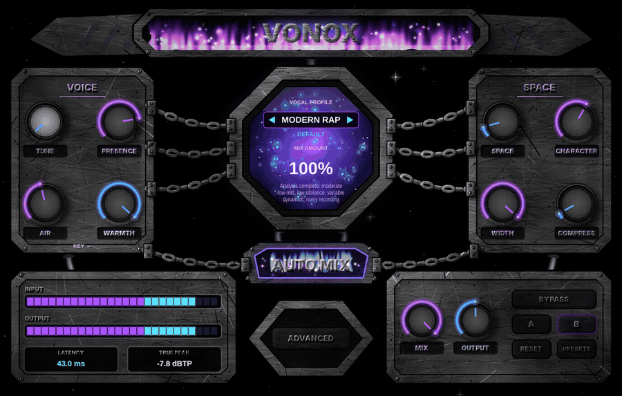

<div align="center">

# VONOX — AI Vocal MIX

### Your vocal, mixed. One click.

A vocal mixing plugin that listens to your voice, then sets up the whole chain for you.<br>
Built for rap, melodic, drill, trap, R&B and pop vocals. VST3, Windows.



**[⬇ Download the installer](../../releases/latest)** · [Video (mp4)](docs/vonox_demo.mp4) · [Build it yourself](#build-it-yourself)

</div>

---

## Why this exists

You record a take, and then comes the hour of fiddling: EQ here, compressor there, de-esser, a bit of saturation, limiter, and still it doesn't sit right. VONOX does that first pass for you.

Hit **AUTO MIX** while your vocal plays. VONOX measures it (levels, dynamics, noise, boxiness, harshness, sibilance) and sets every stage, reverb and delay included, for the vocal profile you picked. Then you tweak, or you don't.

No cloud, no account, no neural network. It's measurements and carefully tuned rules, running on your CPU with **zero latency**.

## What you get

- **AUTO MIX**: analyses your actual vocal and writes the whole chain, effects included. Your voice, not a generic preset.
- **Space and colour, not just correction**: 4 reverbs (Room, Plate, Hall, Chamber), 3 delays (tempo-synced, slapback, ping-pong), a vocal doubler, chorus, stereo width (bass stays mono), a harmonic exciter, tube / tape / soft-clip saturation and parallel compression. Reverb and delay run on their own wet paths and duck under the vocal.
- **72 factory presets** in three groups: Universal, US-rap-inspired, French-rap-inspired. Every one is a different configuration (a test checks it).
- **9 vocal profiles**: Clean Studio, Modern Rap, Melodic Rap, Aggressive Rap, Drill, Trap, R&B, Pop, Custom.
- **Macro knobs**: MIX AMOUNT, SPACE, CHARACTER, WIDTH, COMPRESS, OUTPUT. **ADVANCED** opens every module parameter.
- **A/B slots**, **BYPASS** (smooth 10 ms crossfade) and **LEVEL MATCH**, so you judge the sound and not the volume.
- **Live meters**: input, output, gain reduction.
- **The look**: scratched steel, chains, flames. It's a machine, it should look like one.

## Install

1. Grab **`VONOX-Setup.exe`** from the [latest release](../../releases/latest).
2. Run it. It installs to `C:\Program Files\Common Files\VST3`.
3. In FL Studio: *Options → Manage plugins → Find installed plugins*. VONOX shows up as an effect.

Windows might show a SmartScreen warning: the installer isn't code-signed yet.

## How to use it

1. Put VONOX on your vocal track.
2. Play 3 to 15 seconds of the vocal and press **AUTO MIX**.
3. Pick a profile with ◀ ▶, or click the profile name to open the presets.
4. Adjust **MIX AMOUNT** and **COMPRESS** to taste. Use **A/B** to compare, **LEVEL MATCH** to stay honest.

## Straight talk

This is an early release. Here's what's true today:

- The DSP, the analysis and the plugin logic are covered by automated tests on synthetic signals, and Windows and Linux builds are green on GitHub Actions.
- **I haven't done listening tests on real voices yet** and I haven't loaded it in a DAW myself. The presets are starting points: tune them by ear.
- **Not built yet** (so no control for them, nothing pretends): pitch correction / TUNE, key detection, harmonizer and octave, noise reduction, breath and plosive control, sidechain unmasking, separate ad-lib processing, reference tonal analysis, true-peak metering.
- Saturation isn't oversampled, so very high drive can alias a little. The limiter is a sample-peak one, not true-peak lookahead.
- Fixed window size (1100×700). Windows VST3 only for now.
- The artist-inspired preset groups are *tonal directions with descriptive names*, not copies of anyone's chain, and not endorsed by anyone. See [docs/PRESETS.md](docs/PRESETS.md).

Found a bug or a preset that sounds off? Open an issue, that's exactly the feedback this version needs.

## Build it yourself

Needs CMake 3.22+ and a C++20 compiler. [JUCE](https://juce.com) 8.0.15 is downloaded automatically.

```bash
cmake -S . -B build -G Ninja -DCMAKE_BUILD_TYPE=Release -DVONOX_BUILD_PLUGIN=ON -DVONOX_BUILD_TESTS=ON
cmake --build build
ctest --test-dir build
```

The DSP engine in `src/` is header-only C++20 and doesn't depend on JUCE; the plugin lives in `plugin/`. The Windows installer script is in `installer/`, the CI in `.github/workflows/`.

## License

VONOX is released under the **GNU AGPL v3** (see [LICENSE](LICENSE)). It uses [JUCE](https://juce.com), which is available under the AGPLv3 as well.
