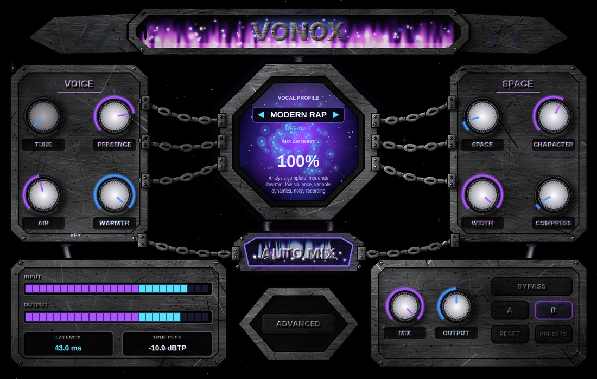

# VONOX — AI Vocal Engine (VST3)

Automatic vocal-mixing plugin. **AUTO MIX** analyses your vocal (levels, dynamics, noise, tonal balance, sibilance) with real DSP measurements and sets a 10-stage chain for the selected vocal profile. "AI" here means adaptive analysis and rules, not a neural network.



## Signal chain (zero latency)
Subtractive EQ (HPF, low-mid, boxiness, harshness) → FET compressor → opto leveler → dynamic resonance control → de-esser → warmth / presence / air → saturation → output trim → stereo-linked peak limiter. Bypass is a 10 ms crossfade to the untouched input.

## Using it
1. Insert on a vocal track, play 3–15 s of the vocal, press **AUTO MIX**.
2. Pick a profile with ◀ ▶ or click the profile box for the factory presets (universal, US-rap-inspired, French-rap-inspired — descriptive tonal references only, see `docs/PRESETS.md`).
3. **MIX AMOUNT** scales every stage's intensity (it is not a dry/wet fader). **COMPRESS**, **LEVEL MATCH**, **A/B**, **BYPASS** as labelled.
4. All finer parameters (FET/opto timings, de-esser frequency, resonance, …) are real automatable parameters exposed in the host's parameter list (in FL Studio: plugin wrapper → parameters).

## Build
Requires CMake ≥ 3.22, a C++20 compiler. JUCE 8.0.15 is fetched automatically.
```
cmake -S . -B build -DVONOX_BUILD_PLUGIN=ON -DVONOX_BUILD_TESTS=ON
cmake --build build --config Release
ctest --test-dir build -C Release
```
Windows: GitHub Actions (`.github/workflows/build.yml`) builds the VST3, runs the tests and produces `VONOX-Setup.exe` (Inno Setup, installs to `C:\Program Files\Common Files\VST3`). In FL Studio: *Options → Manage plugins → Find installed plugins*.

## Honest status
| Item | State |
|---|---|
| DSP, analysis, AUTO MIX, chain | 37 unit/integration tests passing (synthetic signals) |
| Plugin classes (state, A/B, presets, AUTO MIX, bypass, editor) | headless smoke test passing on Linux |
| Windows VST3 + installer | built by CI — **not yet verified by a run in this repo** |
| FL Studio / other hosts | **not tested** |
| Listening tests on real voices | **not done**; presets are starting points that need tuning by ear |
| Saturation | no oversampling yet (some aliasing at high drive) |
| Limiter | sample-peak, non-lookahead hard clamp (not true-peak) |
| De-esser / resonance detectors | per channel (not stereo-linked) |
| Pitch correction | not implemented |
| Resizable UI | no (fixed 1100×700) |

## Licensing
VONOX links **JUCE**, which is dual-licensed (AGPLv3 or a commercial JUCE licence). Distributing binaries requires either releasing VONOX under AGPLv3-compatible terms or holding a JUCE commercial licence. Choose before publishing releases; no licence file is set yet.
