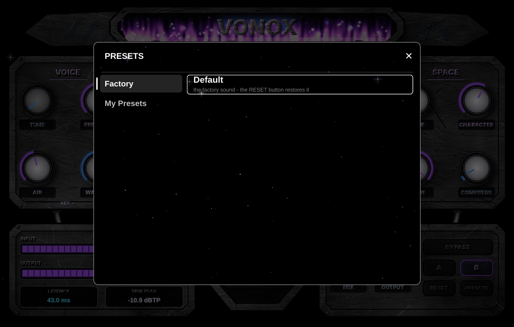

<div align="center">

# VONOX — AI Vocal MIX ( TEST BUILD ONLY )

### Your vocal, mixed. One click.

A vocal mixing plugin that listens to your voice, then sets up the whole chain for you.<br>
Built for rap, melodic, drill, trap, R&B and pop vocals. VST3, Windows.


**[⬇ Download the installer](../../releases/latest)** · [Video (mp4)](docs/vonox_demo.mp4) · [Build it yourself](#build-it-yourself)

</div>

---

## Why this exists

You record a take, and then comes the hour of fiddling: EQ here, compressor there, de-esser, a bit of saturation, limiter, and still it doesn't sit right. VONOX does that first pass for you.

Hit **AUTO MIX** while your vocal plays. VONOX measures it (levels, dynamics, noise, boxiness, harshness, sibilance) and sets every stage, reverb and delay included, for the vocal profile you picked. Then you tweak, or you don't.

No cloud, no account, no neural network: "AI" here means measurement-driven automatic setup. Everything runs on your CPU. The plugin has a fixed latency of about 43 ms (it is reported to your DAW, and bypass stays aligned).

## What you get

- **AUTO MIX**: analyses your actual vocal and writes the whole chain, effects included. It also notices a noisy recording, picks up the key you sing in, and can match the tone of a reference track.
- **One factory preset, "Default"** (the author's tuned settings) and a **RESET** button that brings every parameter back to it. Save your own sounds in the black preset browser (**PRESETS**, "My Presets").
- **Pitch**: automatic **TUNE** (key and scale aware, from natural to hard autotune), two **harmony voices** in key, **octave** up and down.
- **Clean-up**: noise reduction, plosive control, breath control, input gain and auto-level.
- **Space and colour**: 4 reverbs, 3 delays (tempo-synced, slapback, ping-pong), doubler, chorus, stereo width, harmonic exciter, 7 saturation types (oversampled), parallel compression.
- **Sidechain unmasking**: send your beat to the plugin and the vocal finds its place.
- **Safe output**: look-ahead true-peak limiter, live meters, true-peak readout, A/B slots, BYPASS (sample-aligned, shows a clear "BYPASSED" state).
- **The look**: a galaxy-themed machine: scratched steel and chains on a black starfield, violet / blue nebula flames, and stars in the central glass that move with the loudness of your voice.



## Install

1. Grab **`VONOX-Setup.exe`** from the [latest release](../../releases/latest).
2. Run it. It installs to `C:\Program Files\Common Files\VST3`.
3. In FL Studio: *Options → Manage plugins → Find installed plugins*. VONOX shows up as an effect.

Windows might show a SmartScreen warning: the installer isn't code-signed yet.

## How to use it

1. Put VONOX on your vocal track.
2. Play 3 to 15 seconds of the vocal and press **AUTO MIX**.
3. Pick a profile with ◀ ▶, or click the profile name to open the preset browser (↑ ↓ swipe through the list).
4. Adjust **MIX AMOUNT** and **COMPRESS** to taste. **TUNE** is the pitch correction amount; KEY / SCALE and the harmonies are in **ADVANCED**. Use **A/B** to compare, **RESET** to go back to Default.

## Straight talk

This is still a young plugin. The full, line-by-line status is in [docs/STATUS.md](docs/STATUS.md). The short version:

- Every DSP module is covered by automated tests on synthetic signals (tones, noise, bursts), measured on the real output, and the Windows and Linux builds are green on GitHub Actions.
- **Nobody has done listening tests on real voices yet, and I haven't loaded VONOX in FL Studio myself.** The Default preset and AUTO MIX are starting points: tune them by ear. A 20 minute checklist is in [docs/LISTENING_TESTS.md](docs/LISTENING_TESTS.md): if you try it, please open an issue with what you hear.
- **Experimental**: pitch correction, harmonies and octaves (PSOLA: can warble on breathy or very low voices; octave down is a sub-octave synth, not a second voice), noise reduction (steady noise only), breath control, key detection, sidechain unmasking.
- **Partial**: dynamic EQ has one cut band; AD-LIB MODE is a role switch, not a separate processor; the reference match is a coarse 3-band tone match.
- **Missing**: real LUFS meter, formant control, spectrum display, resizable window, macOS / Linux binaries, code signing.

Found a bug or a preset that sounds off? Open an issue, that's exactly the feedback this version needs.

## Build it yourself

Needs CMake 3.22+ and a C++20 compiler. [JUCE](https://juce.com) 8.0.15 is downloaded automatically.

```bash
cmake -S . -B build -G Ninja -DCMAKE_BUILD_TYPE=Release -DVONOX_BUILD_PLUGIN=ON -DVONOX_BUILD_TESTS=ON
cmake --build build
ctest --test-dir build
```

The DSP engine in `src/` is header-only C++20 and doesn't depend on JUCE; the plugin lives in `plugin/`. The Windows installer script is in `installer/`, the CI in `.github/workflows/`.

## License

VONOX is released under the **GNU AGPL v3** (see [LICENSE](LICENSE)). It uses [JUCE](https://juce.com), which is available under the AGPLv3 as well.

<sub>Fonts: Orbitron and Rajdhani (SIL Open Font License 1.1, subsets embedded; licenses in `plugin/assets/fonts/`).</sub>
